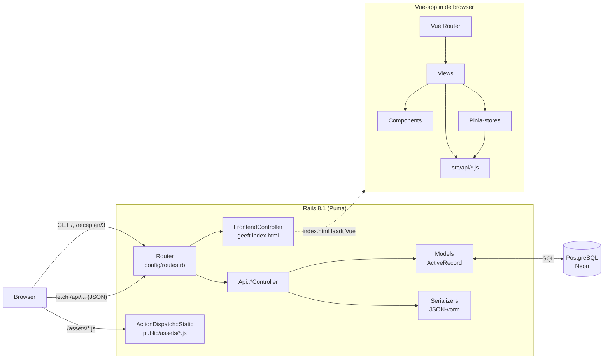
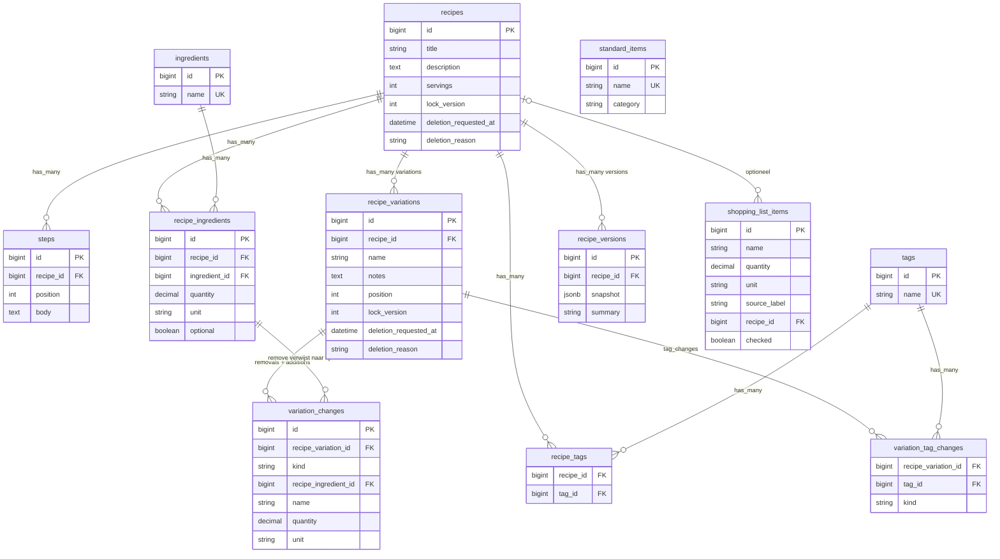
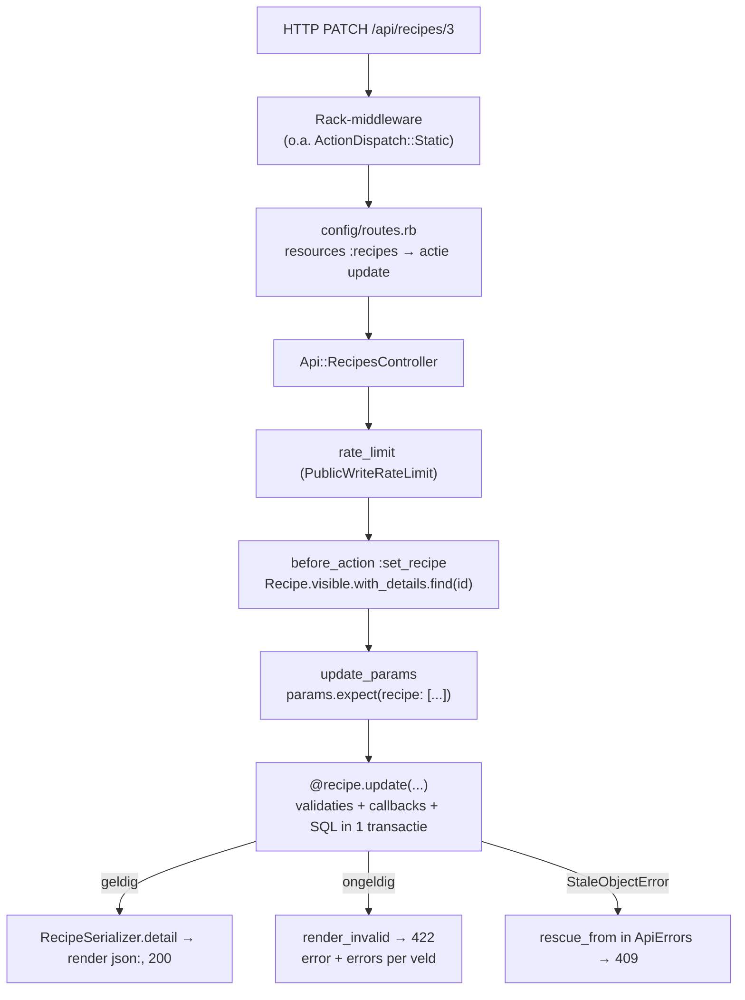
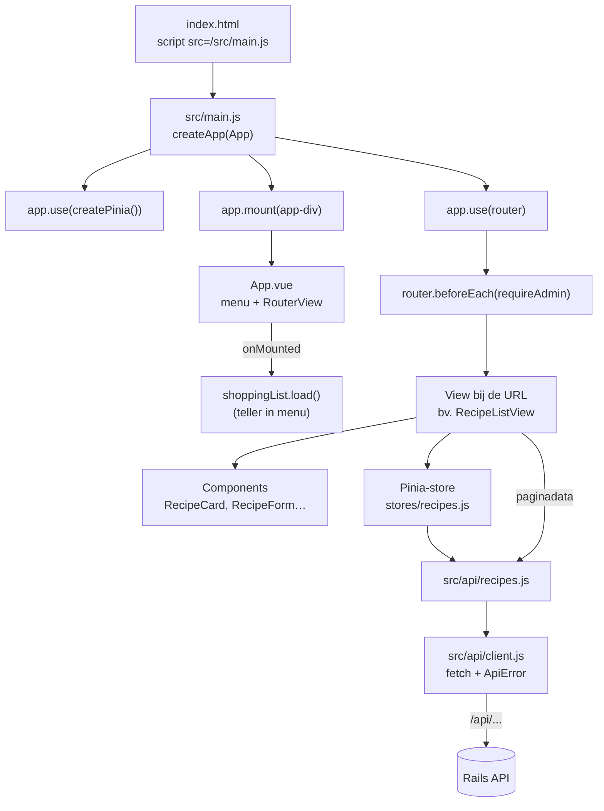
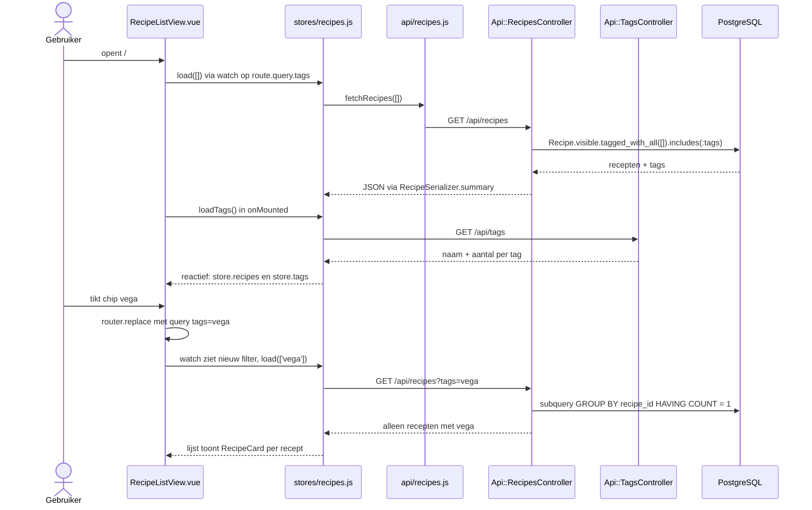
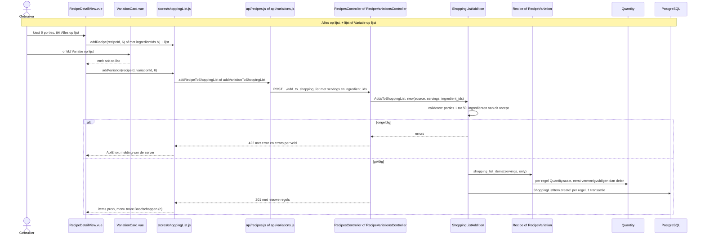
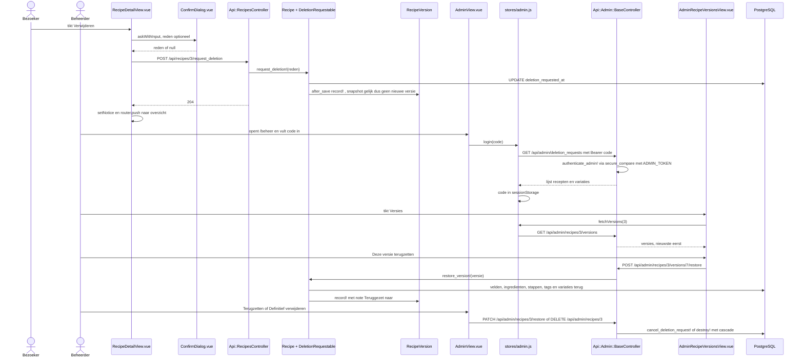

# Code-overzicht receptenapp

Een uitleg voor een junior fullstackontwikkelaar met een Python- (Flask) of Java-achtergrond.
Stand van 14 oktober 2026.

---

## 1. Overzicht

De receptenapp is een **single-page app**. Een Vue 3-frontend draait in de browser en praat via JSON met een **Rails 8.1 API**, die de gegevens in **PostgreSQL** bewaart. In productie (Render, met Neon als database) serveert Rails ook de gebouwde Vue-bestanden. Browser, frontend en API zitten dus op één domein, en CORS is niet nodig. Iedereen met de link kan recepten toevoegen en bewerken en de gedeelde boodschappenlijst gebruiken. Alleen definitief verwijderen en versies terugzetten vragen een **beheercode**.

**Vergelijking**: Rails speelt de rol van Flask én van SQLAlchemy samen (of van Spring Boot met JPA). De Vue-app is wat je in Flask met Jinja-templates zou doen, maar dan volledig in de browser.

---

## 2. Mappenstructuur (alleen wat relevant is)

### Backend (Rails)
| Pad | Wat het doet |
|---|---|
| `config/routes.rb` | Alle URL's: `/api/...` naar controllers, al het andere naar de Vue-app |
| `app/controllers/application_controller.rb` | Basisklasse van alle controllers (`ActionController::API`, dus zonder views of cookies) |
| `app/controllers/frontend_controller.rb` | Geeft `frontend/dist/index.html` terug voor elke HTML-route |
| `app/controllers/api/` | De openbare API: `recipes`, `recipe_variations`, `tags`, `shopping_list_items`, `standard_items`, `not_found` |
| `app/controllers/api/admin/` | Alles met de beheercode; `base_controller.rb` controleert het Bearer-token |
| `app/controllers/concerns/public_write_rate_limit.rb` | Gedeelde limiet op schrijfacties per IP |
| `app/models/` | ActiveRecord-modellen: de tabellen plus hun regels (validaties, callbacks) |
| `app/models/concerns/` | Gedeelde stukjes modelgedrag: `DeletionRequestable`, `DecimalComma` |
| `app/models/quantity.rb` | Hoeveelheden schalen en afronden voor de boodschappenlijst (gespiegeld in `frontend/src/utils/quantity.js` voor het scherm; beide getest met `test/fixtures/files/quantity_cases.json`) |
| `app/models/shopping_list_addition.rb` | "Op lijst" voor een recept of variatie: valideren, schalen, alles-of-niets opslaan |
| `app/controllers/concerns/api_errors.rb` | Eén foutformaat voor de hele API (`rescue_from`) |
| `app/serializers/` | De JSON-vorm van de API, uitgeschreven per veld |
| `config/locales/nl.yml` | Nederlandse namen en foutteksten |
| `db/migrate/` | De migraties (vergelijkbaar met Alembic of Flyway) |
| `db/schema.rb` | De huidige databasestructuur, gegenereerd uit de migraties |
| `test/` | Minitest: `models/`, `controllers/`, `integration/` en `fixtures/` (testdata in YAML) |
| `bin/render-build.sh` | Build op Render: gems, `npm run build`, kopie naar `public/`, migraties |

### Frontend (Vue, in `frontend/`)
| Pad | Wat het doet |
|---|---|
| `index.html` | De HTML-schil waarin Vue zich mount (`
`) |
| `vite.config.js` | Vite-configuratie; in development proxy van `/api` naar Rails op poort 3000 |
| `src/main.js` | Startpunt: maakt de app, koppelt Pinia en de router, en mount |
| `src/App.vue` | De schil: menubalk, `<RouterView/>` en de footer |
| `src/router/index.js` | Welke URL welke view toont, en de guard voor beheer |
| `src/views/` | Eén component per pagina (`RecipeListView`, `RecipeDetailView`, …) |
| `src/components/` | Herbruikbare stukken (`RecipeForm`, `VariationForm`, `TagPicker`, `ConfirmDialog`, …) |
| `src/stores/` | Pinia-stores: gedeelde staat (`recipes`, `shoppingList`, `standardItems`, `admin`) |
| `src/api/` | Alle HTTP-aanroepen; `client.js` is de basis (`fetch` plus foutvertaling) |
| `src/utils/` | Pure functies: `quantity.js` (schalen en notatie), `grouping.js` |
| `src/assets/main.css` | Thema-tokens (kleuren, afstanden) en gedeelde klassen |
| `src/__tests__/` | Vitest-unittests van componenten en stores |
| `e2e/` | Playwright-tests (iPhone-scherm); maakt screenshots in `e2e/screenshots/` |

---

## 3. Datamodel

| Model | Wat het is | Relaties, en waarom |
|---|---|---|
| `Recipe` | Een recept | `has_many :steps`, `:recipe_ingredients`, `:tags (through: :recipe_tags)`, `:variations`, `:versions`. Het is de "aggregate root": het receptformulier bewaart ingrediënten en stappen in één request via `accepts_nested_attributes_for` |
| `Step` | Eén bereidingsstap | `belongs_to :recipe`. `position` wordt door `Recipe#number_steps` gezet, nooit door de client |
| `Ingredient` | Een unieke ingrediëntnaam | `has_many :recipe_ingredients`. Zo is "Bloem" overal dezelfde rij (genormaliseerd naar kleine letters) |
| `RecipeIngredient` | Een regel "200 g bloem" in een recept | `belongs_to :recipe` en `:ingredient`. Hier staan hoeveelheid, eenheid (`g`, `ml`, `stuks`) en `optional` |
| `Tag` / `RecipeTag` | Label ("vega") en koppeltabel | Veel-op-veel: een tag hoort bij veel recepten en een recept heeft veel tags |
| `RecipeVariation` | "Met kip": verschillen ten opzichte van het basisrecept | `belongs_to :recipe`; `has_many :removals` en `:additions` (dezelfde tabel `variation_changes`, gefilterd op `kind`) en `:tag_changes` |
| `VariationChange` | − een rij van het recept, of + een extra ingrediënt | `kind = remove` wijst naar een `recipe_ingredient`, `kind = add` heeft een eigen naam en hoeveelheid. Een check constraint in de database bewaakt dat |
| `VariationTagChange` | + of − een tag in een variatie | `belongs_to :recipe_variation`, `:tag` |
| `RecipeVersion` | Een volledige JSON-kopie van een recept na elke wijziging | `belongs_to :recipe`. Maximaal 50 per recept; nodig om terug te zetten |
| `ShoppingListItem` | Een regel op de ene gedeelde boodschappenlijst | `belongs_to :recipe, optional: true` (alleen als herkomst; wordt NULL als het recept verdwijnt) |
| `StandardItem` | Iets dat je vaak koopt ("melk") | Geen relaties |

**Concerns** (vergelijk met een mixin in Python of een interface met default-methodes in Java):
- `DeletionRequestable` (`app/models/concerns/deletion_requestable.rb`) geeft `Recipe` en `RecipeVariation` de scopes `visible` en `deletion_requested` en de methodes `request_deletion!` en `cancel_deletion_request!`.
- `DecimalComma` zet "1,5" om naar 1.5 voordat Rails het als getal leest.

---

## 4. Backend-flow: hoe een request door Rails gaat

De Rails-conventies die je hier tegenkomt:

| Conventie | In deze app | Vergelijking |
|---|---|---|
| **Convention over configuration** | `resources :recipes` in `routes.rb` levert zeven standaardroutes op, die naar `Api::RecipesController` in `app/controllers/api/recipes_controller.rb` gaan. De klasse `Recipe` hoort bij de tabel `recipes`. Niets daarvan staat in een configuratiebestand | In Flask schrijf je elke `@app.route` zelf; in JPA zet je `@Table` op elke entity |
| **REST-acties** | `index`, `show`, `create`, `update` en `destroy`; extra acties met `member` of `collection` (bijvoorbeeld `post :request_deletion, on: :member`) | Spring: `@GetMapping`, `@PostMapping` |
| **namespace** | `namespace :api` → module `Api::` en URL-prefix `/api`; `namespace :admin` daarbinnen | Een Flask-Blueprint met `url_prefix` |
| **before_action** | `set_recipe` laadt het record voor `show`, `update` en `request_deletion`; `authenticate_admin!` in de admin-basecontroller | `@app.before_request` of een Spring-interceptor |
| **rescue_from** | Exceptions omzetten in een JSON-fout. Op één plek, `app/controllers/concerns/api_errors.rb` (in `ApplicationController`), voor 400, 404, 409 en 422. Elke fout heeft dezelfde vorm: `{ "error": "Nederlandse melding", "errors": { "veld": ["melding"] } }`. Alleen `frontend/src/api/client.js` leest die uit | `@app.errorhandler` of `@ExceptionHandler` in een `@ControllerAdvice` |
| **Strong parameters** | `params.expect(recipe: [:title, ...])` laat alleen toegestane velden door. Ontbreekt de sleutel, dan volgt een 400 | Een whitelist, zoals een DTO of een Marshmallow-schema |
| **ActiveRecord** | `Recipe.visible.tagged_with_all(...)` bouwt SQL via scopes (herbruikbare queryfragmenten) | SQLAlchemy-query of een Spring Data `Specification` |
| **Validaties** | `validates :title, presence: true` in het model, plus `null: false` en check constraints in de database | Bean Validation (`@NotNull`) plus databaseconstraints |
| **Callbacks** | `before_validation :number_steps`, `before_save :link_tags`, `after_save :record_version` in `Recipe` | JPA `@PrePersist` en `@PostUpdate` |
| **Nested attributes** | `accepts_nested_attributes_for :steps` laat één request recept + stappen + ingrediënten opslaan (`steps_attributes: [...]`, met `_destroy: true` om een rij te verwijderen) | Cascade-persist in JPA |
| **Optimistic locking** | De kolom `lock_version`: Rails voegt `WHERE lock_version = ?` toe, en als een ander eerder was volgt `StaleObjectError`, wat de API als 409 terugstuurt | `@Version` in JPA |
| **Serializer-module** | Gewone Ruby-modules (`RecipeSerializer.detail(recipe)`) die een hash bouwen | Een DTO-mapper |

---

## 5. Frontend-flow: hoe de Vue-app opstart

- **Vite** is de bouwtool en de dev-server. Met `npm run dev` serveert Vite de bronbestanden direct, met hot reload, en stuurt het `/api` door naar Rails (`vite.config.js:23-26`). Met `npm run build` maakt het een geoptimaliseerde map `frontend/dist/` (index.html plus JS en CSS met een hash in de naam). `bin/render-build.sh` kopieert die naar `public/`. Vergelijk met webpack, of met de Maven-build die een `.jar` maakt.
- **Vue Router** (`src/router/index.js`) koppelt een URL aan een view, net als `routes.rb`, maar dan in de browser. `props: true` geeft `:id` als prop door.
- **Views en components**: `<script setup>` met de Composition API. `ref()` is reactieve staat, `computed()` een afgeleide waarde, `watch()` reageert op veranderingen. **Props** gaan naar beneden (ouder → kind), **emits** naar boven (kind → ouder).
- **Pinia-stores** zijn gedeelde, reactieve staat buiten de componenten (vergelijk met een singleton-service in Spring, of met een module-level object in Python, maar dan reactief). Hier: de receptenlijst en het filter, de boodschappenlijst, de standaardlijst en de beheercode. Data die bij één pagina hoort (het recept op de detailpagina) haalt de view zelf op via `src/api/`.
- **`src/api/client.js`** doet alle `fetch`-aanroepen en zet HTTP-fouten om in een `ApiError` met een `kind` (`not_found`, `validation`, `conflict`, …), de Nederlandse melding van de server (`error`) en de fouten per veld (`errors`). Het is de enige plek die het foutformaat van de API uitleest.

---

## 6. Drie flows van begin tot eind

### a. Receptenoverzicht laden en filteren op tags

Bestanden in volgorde:
1. `frontend/src/router/index.js` → route `/` toont `RecipeListView`.
2. `frontend/src/views/RecipeListView.vue`: `selectedTags` komt uit de URL (regels 15-20); `watch` roept `store.load` aan (regels 51-55); `toggle` en `setTags` passen de URL aan (regels 37-47).
3. `frontend/src/stores/recipes.js`: `load()` met de bescherming "laatste antwoord wint" (regels 42-55) en `loadTags()`.
4. `frontend/src/api/recipes.js`: `fetchRecipes` en `fetchTags`.
5. `config/routes.rb` → `resources :recipes` en `resources :tags`.
6. `app/controllers/api/recipes_controller.rb#index` en `app/controllers/api/tags_controller.rb#index`.
7. `app/models/recipe.rb`: de scopes `visible` (uit `DeletionRequestable`) en `tagged_with_all`.
8. `app/serializers/recipe_serializer.rb#summary`.
9. `frontend/src/components/RecipeCard.vue` toont elke kaart.

Waarom het filter in de URL staat en niet in de store: dan werkt "terug" en kun je een gefilterde link delen.

### b. Een recept of een variatie op de boodschappenlijst zetten

Eén pad voor beide: de browser zegt alleen **wat** (recept, of één ingrediënt, of een variatie) en **voor hoeveel porties**. De server rekent en slaat op ("fat model, thin client"). Het live schalen op de receptpagina blijft in de browser (`quantity.js`), zodat niet elke tik op + of − een request is. Dat de twee hetzelfde afronden, bewaken dezelfde testgevallen in `test/fixtures/files/quantity_cases.json`, die zowel Minitest als Vitest inleest.

Bestanden in volgorde:
1. `frontend/src/views/RecipeDetailView.vue`: `scaledIngredients` voor het scherm (regel 102), `addToShoppingList`, `addToList` en `addAllToList` (regels 134-160), `addVariationToList` (regel 252).
2. `frontend/src/components/VariationCard.vue`: de knop emit `add-to-list`.
3. `frontend/src/stores/shoppingList.js`: `addRecipe` en `addVariation` (regels 65-75).
4. `frontend/src/api/recipes.js#addRecipeToShoppingList` en `frontend/src/api/variations.js#addVariationToShoppingList`.
5. `config/routes.rb`: `post :add_to_shopping_list` als member van `recipes` en van `variations`.
6. `app/controllers/api/recipes_controller.rb#add_to_shopping_list` en `app/controllers/api/recipe_variations_controller.rb#add_to_shopping_list`: elk één regel, die `add_to_shopping_list_from` aanroept uit `app/controllers/concerns/adds_to_shopping_list.rb`.
7. `app/models/shopping_list_addition.rb`: een form object (ActiveModel, geen tabel) dat valideert en alles-of-niets opslaat.
8. `app/models/recipe.rb#shopping_list_items` en `app/models/recipe_variation.rb#shopping_list_items`: welke regels; `ShoppingListItem.lines_for` schaalt ze met `app/models/quantity.rb`.
9. `app/serializers/shopping_list_item_serializer.rb`.
10. `frontend/src/App.vue`: `shoppingLabel` gebruikt de getter `openCount` van de store.

De standaardlijst ("op lijst" zonder hoeveelheid) gebruikt nog de gewone bulk-insert `POST /api/shopping_list_items`, want daar valt niets te rekenen.

### c. Een verwijderverzoek indienen en afhandelen met de beheercode (en de versiegeschiedenis)

Bestanden in volgorde:
1. `frontend/src/views/RecipeDetailView.vue#askDeletion` (regels 37-58) met `frontend/src/components/ConfirmDialog.vue#askWithInput`.
2. `frontend/src/api/recipes.js#requestDeletion`.
3. `config/routes.rb`: `post :request_deletion, on: :member`.
4. `app/controllers/api/recipes_controller.rb#request_deletion`.
5. `app/models/concerns/deletion_requestable.rb#request_deletion!`. Vanaf dat moment filtert de scope `visible` het recept overal weg.
6. `app/models/recipe.rb`: de callbacks `record_original_version`, `touch_for_locking` en `record_version`; `app/models/recipe_version.rb#record!` slaat geen versie op als er niets veranderd is.
7. `frontend/src/views/AdminView.vue` → `frontend/src/stores/admin.js#login` en `#call` (logt automatisch uit bij een 401) → `frontend/src/api/admin.js` (Bearer-header).
8. `app/controllers/api/admin/base_controller.rb#authenticate_admin!`.
9. `app/controllers/api/admin/deletion_requests_controller.rb#index`.
10. `frontend/src/views/AdminRecipeVersionsView.vue` → `app/controllers/api/admin/recipe_versions_controller.rb` → `Recipe#restore_version!`.
11. `app/controllers/api/admin/recipes_controller.rb#restore` en `#destroy`. Voor variaties: `app/controllers/api/admin/recipe_variations_controller.rb`. Bij `destroy!` ruimt Rails stappen, ingrediënten en tags op; de database verwijdert versies en variaties (`on_delete: :cascade`) en zet `shopping_list_items.recipe_id` op NULL.

---

## 7. Waar moet ik zijn als ik X wil aanpassen?

| Ik wil… | Bestanden, in deze volgorde |
|---|---|
| **Een nieuw veld aan een recept toevoegen** (bv. `prep_minutes`) | 1. `bin/rails g migration AddPrepMinutesToRecipes prep_minutes:integer` → `db/migrate/…` → `bin/rails db:migrate` (werkt `db/schema.rb` bij). 2. Validatie in `app/models/recipe.rb`. 3. `config/locales/nl.yml` (attribuutnaam). 4. Toestaan in `create_params` en `update_params` in `app/controllers/api/recipes_controller.rb`. 5. Toevoegen aan `SUMMARY_FIELDS` of `detail` in `app/serializers/recipe_serializer.rb`. 6. Is het onderdeel van de geschiedenis, dan ook in `RecipeVersion.snapshot_of`, `PARTS` en `Recipe#restore_version!`. 7. Het formulierveld in `frontend/src/components/RecipeForm.vue` (`form` en de template). 8. Tonen in `frontend/src/views/RecipeDetailView.vue` en/of `components/RecipeCard.vue`. 9. Tests: `test/models/recipe_test.rb`, `test/controllers/api/recipes_controller_test.rb`, `src/__tests__/RecipeForm.spec.js` |
| Een nieuwe pagina | `frontend/src/views/NieuwView.vue` → route in `src/router/index.js` → link in `src/App.vue` |
| Een nieuw API-endpoint | `config/routes.rb` → controller in `app/controllers/api/` → functie in `frontend/src/api/*.js` → store of view |
| Een Nederlandse foutmelding aanpassen | `config/locales/nl.yml` (server) of `frontend/src/api/client.js` (algemene meldingen) |
| Kleuren of afstanden | De tokens in `frontend/src/assets/main.css` |
| Afronding van hoeveelheden | Eerst een geval in `test/fixtures/files/quantity_cases.json`, dan `app/models/quantity.rb` **én** `frontend/src/utils/quantity.js` tot beide tests groen zijn |
| Een nieuwe foutmelding | `config/locales/nl.yml` (`api.*`), en bij een nieuw soort fout een `rescue_from` in `app/controllers/concerns/api_errors.rb` |
| Een nieuwe eenheid (bv. `el`) | Check constraints via een migratie (`recipe_ingredients`, `variation_changes`), de `enum :unit` in `recipe_ingredient.rb` en `variation_change.rb`, `UNITS` en `MINIMUM` in `quantity.js`, `MINIMUM` in `quantity.rb` |
| Wat openbaar is en wat beheer | `config/routes.rb` (namespace `admin`) en `app/controllers/api/admin/base_controller.rb` |
| De rate limits | `app/controllers/concerns/public_write_rate_limit.rb` en `SUBMISSIONS_PER_HOUR` in `recipes_controller.rb` |

---

## 8. Begrippenlijst

| Term | Betekenis | Vergelijkbaar met |
|---|---|---|
| **ActiveRecord** | De ORM van Rails: een klasse per tabel en een object per rij | SQLAlchemy, JPA/Hibernate |
| **Migratie** | Een versioneerbare wijziging van het databaseschema | Alembic, Flyway |
| **`schema.rb`** | Een gegenereerd overzicht van het huidige schema | – |
| **Scope** | Een benoemd, herbruikbaar queryfragment (`Recipe.visible`) | Een SQLAlchemy-queryfunctie, Spring Data Specification |
| **Association** (`has_many`, `belongs_to`, `through`) | Relaties tussen modellen | `relationship()`, `@OneToMany` |
| **Validation** | Regels die gecontroleerd worden voor het opslaan | Bean Validation, Marshmallow |
| **Callback** (`before_save`, `after_save`) | Code die automatisch draait rond opslaan of valideren | `@PrePersist`, SQLAlchemy events |
| **Concern** | Een module met gedeeld gedrag voor modellen of controllers | Mixin, of een interface met default-methodes |
| **`normalizes`** | Schoont een attribuut op bij het toewijzen én in queries | Een setter met normalisatie |
| **`accepts_nested_attributes_for`** | Kindrecords opslaan via de ouder (`steps_attributes`) | Cascade persist |
| **`lock_version`** | Optimistic locking: een conflict geeft een 409 | `@Version` |
| **Strong parameters** (`params.expect`) | Een whitelist voor requestvelden | DTO, request-schema |
| **`before_action`** | Een filter dat voor een controlleractie draait | `before_request`, interceptor |
| **`rescue_from`** | Een exception omzetten in een response | `errorhandler`, `@ExceptionHandler` |
| **`rate_limit`** | Ingebouwde Rails 8-limiet per IP | Flask-Limiter |
| **Fixtures** | YAML-testdata in `test/fixtures/` | pytest-fixtures, DbUnit |
| **Single-page app (SPA)** | Eén HTML-pagina, de rest doet JavaScript | – |
| **Vite** | Dev-server plus bundler | webpack, Maven-build voor de frontend |
| **Component (`.vue`)** | Template, script en style in één bestand | Een Jinja-template met eigen logica |
| **`<script setup>`** | Compacte schrijfwijze van de Composition API | – |
| **`ref` / `reactive`** | Reactieve variabele of reactief object: de UI ververst vanzelf | Observable |
| **`computed`** | Afgeleide waarde die zichzelf herberekent | `@property` die reageert op wijzigingen |
| **`watch`** | Code draaien als een waarde verandert | Een listener of observer |
| **Props / emits** | Data naar een kind / events naar de ouder | Constructorparameters / callbacks |
| **`v-model`** | Two-way binding tussen een formulierveld en staat | – |
| **`defineExpose`** | Methodes van een component beschikbaar maken voor de ouder (via `ref`) | Een publieke methode |
| **Composable** | Een herbruikbare functie met reactieve staat (`useX()`) | Een hulpklasse of service |
| **Pinia-store** | Gedeelde reactieve staat met acties en getters | Een singleton-service (Spring) of een module-level state-object |
| **Vue Router / navigation guard** | URL → view; `beforeEach` draait voor elke navigatie | Flask-routes / een `before_request`-check |
| **`ApiError`** | Eigen fouttype in `client.js` met `kind`, `message` en `errors` | Een eigen exceptionklasse |
| **Form object** (`ActiveModel::Model`) | Een klasse zonder tabel met validaties en `errors`, zoals `ShoppingListAddition` | Een DTO met Bean Validation, een WTForms-formulier |
| **`file_fixture_path`** | De map `test/fixtures/files` voor testbestanden, hier de gedeelde hoeveelheidstests | `src/test/resources` |
| **Vitest / Playwright** | Unit-tests in jsdom / end-to-end-tests in een echte browser | pytest / Selenium |
