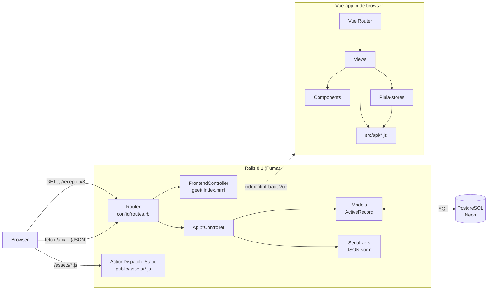
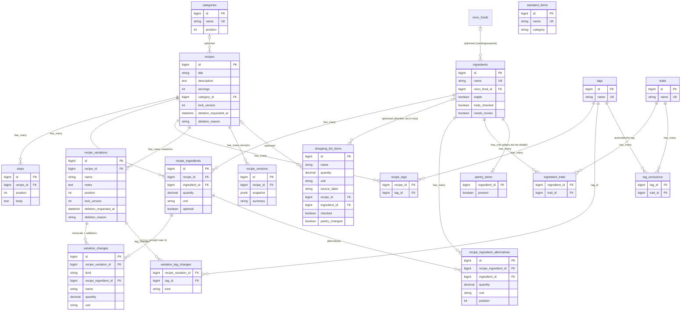
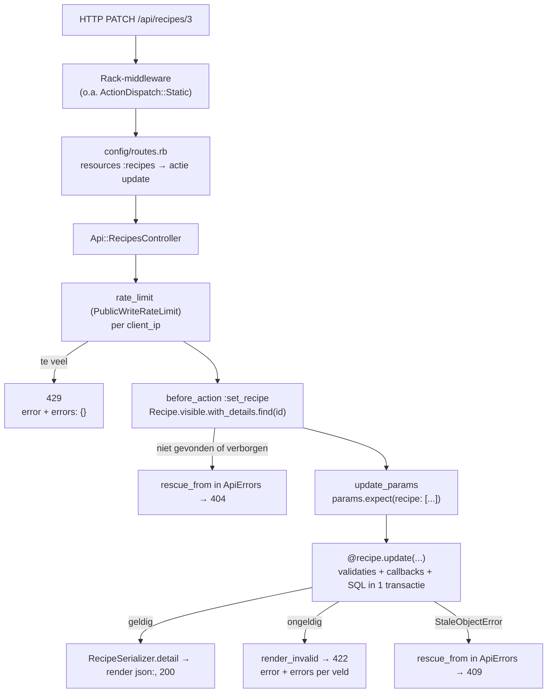
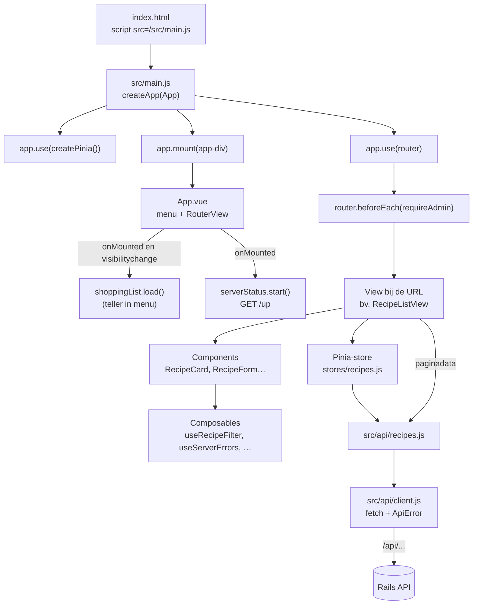
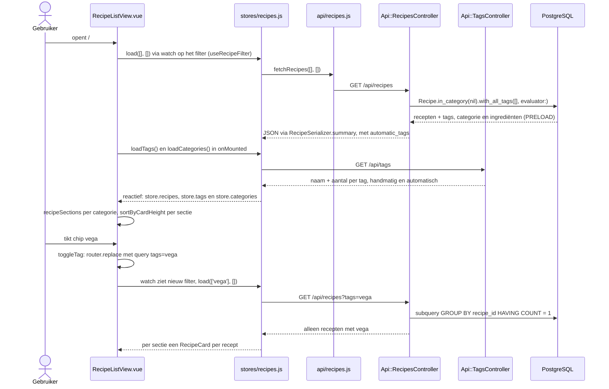
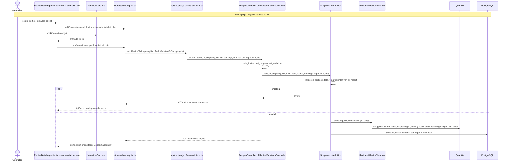
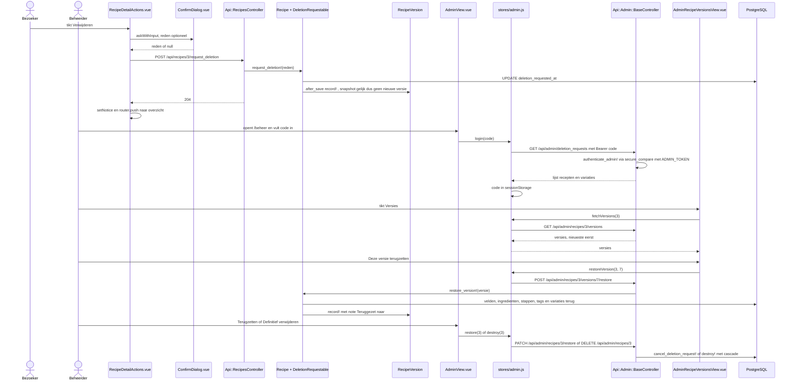
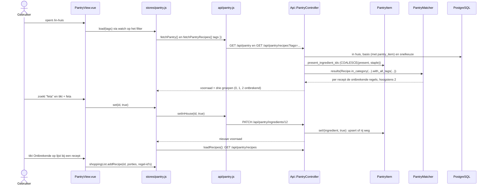

# Code-overzicht receptenapp

Een uitleg voor een junior fullstackontwikkelaar met een Python- (Flask) of Java-achtergrond.
Laatst gecontroleerd tegen commit `8c01511` plus de opruimronde van 17 oktober 2026.

---

## 1. Overzicht

De receptenapp is een **single-page app**. Een Vue 3-frontend draait in de browser en praat via JSON met een **Rails 8.1 API**, die de gegevens in **PostgreSQL** bewaart. In productie (Render, met Neon als database) serveert Rails ook de gebouwde Vue-bestanden. Browser, frontend en API zitten dus op één domein, en CORS is niet nodig. Iedereen met de link kan recepten toevoegen en bewerken en de gedeelde boodschappenlijst en voorraad ("In huis") gebruiken. Alleen het afhandelen van verwijderverzoeken (definitief verwijderen of terugzetten) en de versiegeschiedenis vragen een **beheercode**.

**Vergelijking**: Rails speelt de rol van Flask én van SQLAlchemy samen (of van Spring Boot met JPA). De Vue-app is wat je in Flask met Jinja-templates zou doen, maar dan volledig in de browser.

---

## 2. Mappenstructuur (alleen wat relevant is)

### Backend (Rails)
| Pad | Wat het doet |
|---|---|
| `config/routes.rb` | Alle URL's: `/api/...` naar controllers, al het andere naar de Vue-app |
| `app/controllers/application_controller.rb` | Basisklasse van alle controllers (`ActionController::API`, dus zonder views of cookies), met de concerns `ApiErrors` en `ClientIp`, de header `X-App-Version` en `boolean_param` ("true"/"false" uit een request naar een boolean) |
| `app/controllers/frontend_controller.rb` | Geeft `frontend/dist/index.html` terug voor elke HTML-route |
| `app/controllers/api/` | De openbare API: `recipes`, `recipe_variations`, `tags`, `categories`, `ingredients` (NEVO-koppeling, kenmerken en basis), `traits`, `nevo_foods`, `pantry` ("In huis"), `shopping_list_items`, `standard_items`, `versions` en `not_found` |
| `app/controllers/api/admin/` | Alles met de beheercode; `base_controller.rb` controleert het Bearer-token en heeft de rate limit voor beheer |
| `app/controllers/concerns/` | Gedeeld controllergedrag: `ApiErrors` (één foutformaat via `rescue_from`), `ClientIp` (wie de bezoeker is achter Cloudflare), `PublicWriteRateLimit` (limiet op openbare schrijfacties), `AddsToShoppingList` ("op lijst" voor recept en variatie) |
| `app/models/` | ActiveRecord-modellen: de tabellen plus hun regels (validaties, callbacks) |
| `app/models/concerns/` | Gedeelde stukjes modelgedrag: `DeletionRequestable` (verwijderverzoeken), `DecimalComma` ("1,5"), `TagNames` (tagnamen normaliseren en controleren), `HasQuantity` (hoeveelheid met eenheid; gebruikt `DecimalComma`), `NamedIngredient` (een regel die een ingrediënt bij naam noemt) |
| `app/models/quantity.rb` | Hoeveelheden schalen en afronden voor de boodschappenlijst (gespiegeld in `frontend/src/utils/quantity.js` voor het scherm; beide getest met `test/fixtures/files/quantity_cases.json`) |
| `app/models/shopping_list_addition.rb` | "Op lijst" voor een recept of variatie: valideren, schalen, alles-of-niets opslaan (een form object, geen tabel) |
| `app/models/pantry_matcher.rb`, `ingredient_search.rb` | Rekenklassen zonder tabel: welke recepten je kunt maken met wat in huis is ("In huis"), en welke recepten een gekozen ingrediënt bevatten ("Met ingrediënt…") |
| `app/models/recipe_tag_evaluator.rb`, `nutrition.rb`, `ingredient_merge.rb` | Ook zonder tabel: de automatische tags, de voedingswaarde en het samenvoegen van twee ingrediënten |
| `app/serializers/` | De JSON-vorm van de API, uitgeschreven per veld |
| `config/locales/nl.yml` | Nederlandse namen en foutteksten |
| `db/migrate/` | De migraties (vergelijkbaar met Alembic of Flyway) |
| `db/schema.rb` | De huidige databasestructuur, gegenereerd uit de migraties |
| `db/seeds.rb` | Wat een nieuwe database nodig heeft (startcategorieën, kenmerken en automatische tags, basisvoorraad): dezelfde gegevens als de migraties die ze in productie aanmaakten |
| `lib/importers/`, `lib/tasks/`, `db/import/` | Eenmalige en terugkerende imports als rake-taken (`import:*`, `nevo:*`, `ingredients:cleanup`, `traits:setup`), met hun invoerbestanden. Elke taak print eerst op welke database hij werkt (`Importers::Base.database_line`) |
| `test/` | Minitest: `models/`, `controllers/`, `integration/`, `lib/`, `tasks/`, `migrations/` (de data-migraties) en `fixtures/` (testdata in YAML; `fixtures/files/` voor testbestanden zoals `quantity_cases.json`) |
| `bin/render-build.sh` | Build op Render: gems, `npm run build`, kopie naar `public/`, migraties |

### Frontend (Vue, in `frontend/`)
| Pad | Wat het doet |
|---|---|
| `index.html` | De HTML-schil waarin Vue zich mount (`
`) |
| `vite.config.js` | Vite-configuratie: in development een proxy van `/api` en `/up` naar Rails op poort 3000 (of `API_TARGET`), de service worker (PWA) en de versie van de build |
| `src/main.js` | Startpunt: maakt de app, koppelt Pinia en de router, en mount |
| `src/App.vue` | De schil: menubalk (Recepten, In huis, Recept, Boodschappen, Standaard, Ingrediënten), `<RouterView/>`, de footer en de laadmelding zolang de server wakker wordt (`ServerWaiting`) |
| `src/router/index.js` | Welke URL welke view toont, en de guard voor beheer |
| `src/views/` | Eén component per pagina (`RecipeListView`, `RecipeDetailView`, …) |
| `src/components/` | Herbruikbare stukken (`RecipeForm`, `VariationForm`, `TagPicker`, `ConfirmDialog`, …) en de delen van de receptpagina (`RecipeDetailServings`, `-Ingredients`, `-Steps`, `-Variations`, `-Actions`) |
| `src/composables/` | Herbruikbare functies met reactieve staat: `useServerErrors` (veldfouten van de server in een formulier), `useConfirmDialog` (één bevestigingsvenster per pagina, via provide/inject), `useRecipeFilter` (categorie, tags en ingrediënten in de URL; gedeeld door Recepten en In huis), `useIngredientNames` (alle ingrediënten, één keer per bezoek opgehaald), `useTraitSaver` (kenmerken opslaan, één verzoek tegelijk per ingrediënt) |
| `src/stores/` | Pinia-stores: gedeelde staat (`recipes`, `pantry`, `shoppingList`, `standardItems`, `admin`, `serverStatus`) |
| `src/api/` | Alle HTTP-aanroepen; `client.js` is de basis (`fetch` plus foutvertaling) |
| `src/utils/` | Pure functies: `quantity.js` (schalen en notatie, `UNITS`, `DEFAULT_UNIT`), `grouping.js`, `categories.js` (secties en categoriefilter), `sortRecipes.js` (kaartvolgorde en tags op de kaart), `automaticTags.js`, `alternatives.js` (wissels), `ingredientSearch.js` (ingrediënt zoeken, `searchWords`), `similarIngredient.js` ("Bedoel je…?"), `nutrition.js`, `traits.js`, `format.js` (datum en tijd op de beheerpagina's) |
| `src/offline/` | Offline voor de boodschappenlijst: een kopie in localStorage (snapshot) en een wachtrij voor afvinken zonder verbinding |
| `src/version.js` | Herlaadt de pagina als de server een nieuwere build draait (header `X-App-Version`) |
| `src/assets/main.css` | Thema-tokens (kleuren, afstanden) en gedeelde klassen |
| `src/__tests__/` | Vitest-unittests van views, componenten, stores, composables, `client.js`, de router, `offline/` en `utils/` |
| `e2e/` | Playwright-tests (iPhone-scherm, een paar ook op desktop) tegen een eigen Rails en Vite; maakt screenshots in `e2e/screenshots/` |

---

## 3. Datamodel

Per tabel staan hier alleen de kolommen die je nodig hebt om de relaties te begrijpen; `ingredients` heeft bijvoorbeeld ook de omrekeningen en etiketwaarden (`grams_per_piece`, `label_kcal`, …), `nevo_foods` de voedingsstoffen. De volledige lijst staat in `db/schema.rb`.

**Constraints in de database** (in `db/schema.rb`; de modellen hebben dezelfde regels als validatie, zodat je een nette 422 krijgt in plaats van een databasefout):
- `recipe_ingredients`, `variation_changes` en `shopping_list_items` hebben elk drie check constraints: `*_quantity_positive` (hoeveelheid > 0), `*_unit_known` (`g`, `ml`, `stuks`, `tl` of `el`) en `*_quantity_has_unit` (hoeveelheid en eenheid zijn samen leeg of samen gevuld; leeg = "naar smaak").
- `variation_changes` heeft daarnaast `variation_changes_kind_known` en `variation_changes_fields_match_kind`: een `remove` heeft alleen `recipe_ingredient_id`, een `add` alleen een eigen naam (en eventueel hoeveelheid). `variation_tag_changes` heeft `variation_tag_changes_kind_known`.
- `steps`: `position > 0`, en `(recipe_id, position)` is uniek, *deferrable*: Postgres controleert dat pas aan het eind van de transactie, zodat stappen tussendoor van plek kunnen wisselen.
- Unieke indexen op `ingredients.name`, `tags.name`, `standard_items.name`, `recipe_ingredients (recipe_id, ingredient_id)` en `recipe_tags (recipe_id, tag_id)`.

| Model | Wat het is | Relaties, en waarom |
|---|---|---|
| `Recipe` | Een recept | `has_many :steps`, `:recipe_ingredients`, `:tags (through: :recipe_tags)`, `:variations`, `:versions`. Het is de "aggregate root": het receptformulier bewaart ingrediënten en stappen in één request via `accepts_nested_attributes_for` |
| `Step` | Eén bereidingsstap | `belongs_to :recipe`. `position` wordt door `Recipe#number_steps` gezet, nooit door de client |
| `Category` | Een receptcategorie ("Ontbijt", "Diner") met een vaste volgorde (`position`) | `has_many :recipes`. Een recept zonder categorie staat onder "Overig"; die naam is daarom gereserveerd |
| `Ingredient` | Een unieke ingrediëntnaam, met de NEVO-koppeling, omrekeningen, kenmerken en of het basisvoorraad is (`staple`) | `has_many :recipe_ingredients`, `:traits (through: :ingredient_traits)`, `has_one :pantry_item`, `belongs_to :nevo_food` (optioneel). Zo is "Bloem" overal dezelfde rij (genormaliseerd naar kleine letters). De scope `with_details` laadt wat de serializer nodig heeft; `Ingredient.for_additions(variations)` zoekt de ingrediënten bij de toevoegingen van variaties op naam op |
| `RecipeIngredientAlternative` | "of: tofu" onder "250 g kip" | `belongs_to :recipe_ingredient` en `:ingredient`. Zonder eigen hoeveelheid geldt die van de regel (`effective_quantity`) |
| `Trait` / `IngredientTrait` / `TagExclusion` | Kenmerken (vlees, vis, dierlijk, gluten, lactose), welke een ingrediënt heeft, en welke een tag uitsluit | Een tag met uitsluitingen is automatisch ("vegetarisch" sluit vlees en vis uit). `RecipeTagEvaluator` rekent ermee |
| `NevoFood` | Een product uit NEVO-online met voedingswaarden | `has_many :ingredients`. Alleen geïmporteerd, nooit gewijzigd |
| `PantryItem` | "In huis": een rij alleen waar de voorraad afwijkt van de standaard | `belongs_to :ingredient`. Een basisingrediënt (`staple`) is in huis tenzij `present: false` ("op"); elk ander ingrediënt is er niet, tenzij `present: true`. "Terug naar standaard" is dus alle rijen weggooien |
| `RecipeIngredient` | Een regel "200 g bloem" in een recept | `belongs_to :recipe` en `:ingredient`. Hier staan hoeveelheid, eenheid (`g`, `ml`, `stuks`, via `HasQuantity`) en `optional` |
| `Tag` / `RecipeTag` | Label ("vega") en koppeltabel | Veel-op-veel: een tag hoort bij veel recepten en een recept heeft veel tags |
| `RecipeVariation` | "Met kip": verschillen ten opzichte van het basisrecept | `belongs_to :recipe`; `has_many :removals` en `:additions` (dezelfde tabel `variation_changes`, gefilterd op `kind`) en `:tag_changes` |
| `VariationChange` | − een rij van het recept, of + een extra ingrediënt | `kind = remove` wijst naar een `recipe_ingredient`, `kind = add` heeft een eigen naam en hoeveelheid. Een check constraint in de database bewaakt dat |
| `VariationTagChange` | + of − een tag in een variatie | `belongs_to :recipe_variation`, `:tag` |
| `RecipeVersion` | Een volledige JSON-kopie van een recept na elke wijziging | `belongs_to :recipe`. Maximaal 50 per recept; nodig om terug te zetten |
| `ShoppingListItem` | Een regel op de ene gedeelde boodschappenlijst | `belongs_to :recipe, optional: true` (alleen als herkomst; wordt NULL als het recept verdwijnt) en `belongs_to :ingredient, optional: true`. Afvinken zet het ingrediënt in huis (`PantryItem.set!`); `pantry_changed` onthoudt of dat iets veranderde, zodat weer aanvinken het alleen dan terugdraait. Hoeveelheid en eenheid via `HasQuantity` |
| `ShoppingListAddition` | Geen tabel: een form object voor "op lijst" | Krijgt een `Recipe` of `RecipeVariation` als `source`, valideert porties en ingrediënten, vraagt de bron om `shopping_list_items` en slaat alles in één transactie op |
| `StandardItem` | Iets dat je vaak koopt ("melk") | Geen relaties |

**Klassen zonder tabel** (gewone Ruby-klassen in `app/models/`, vergelijk met een service-klasse in Spring of een module met functies in Python):
- `PantryMatcher` (`app/models/pantry_matcher.rb`): welke recepten je kunt maken met wat in huis is. Per recept de regels die ontbreken; een regel is er als het eigen ingrediënt of een van de alternatieven in huis is, optionele regels tellen nooit mee. Alleen recepten met hoogstens `MAX_MISSING` (2) ontbrekende regels, minst ontbrekend eerst, dan op titel.
- `IngredientSearch` (`app/models/ingredient_search.rb`): "Met ingrediënt…" op het receptentabblad. Gebruikt `PantryMatcher.covering` en `#missing`, met de gekozen ingrediënten als in huis.
- `RecipeTagEvaluator`: de automatische tags (ja, met_wissel of nee) uit de kenmerken van de ingrediënten.
- `Nutrition`: de voedingswaarde van een recept of variatie, bij elk opvragen uitgerekend.
- `IngredientMerge`: twee ingrediënten samenvoegen (alleen met de beheercode).
- `ShoppingListAddition`: zie hierboven.

**Concerns** (vergelijk met een mixin in Python of een interface met default-methodes in Java):
- `DeletionRequestable` (`app/models/concerns/deletion_requestable.rb`) geeft `Recipe` en `RecipeVariation` de scopes `visible` en `deletion_requested` en de methodes `request_deletion!` en `cancel_deletion_request!`.
- `DecimalComma` zet "1,5" om naar 1.5 voordat Rails het als getal leest. Je gebruikt hem niet los meer: `HasQuantity` doet het.
- `HasQuantity` (`app/models/concerns/has_quantity.rb`) geeft `RecipeIngredient`, `VariationChange` en `ShoppingListItem` dezelfde regels voor hoeveelheid en eenheid: komma omzetten, eenheid wissen zonder hoeveelheid, hoeveelheid > 0 en eenheid verplicht bij een hoeveelheid. Twee macro's: `unit_enum` (eenheid als enum) en `has_quantity`. Hier staat ook `UNITS`.
- `NamedIngredient` (`app/models/concerns/named_ingredient.rb`) geeft `RecipeIngredient` en `RecipeIngredientAlternative` `ingredient_name`: het ingrediënt wordt bij naam opgezocht, of pas aangemaakt als het hele recept geldig is.
- `TagNames` (`app/models/concerns/tag_names.rb`) geeft `Recipe` en `RecipeVariation` `normalize_tag_names` en `validate_tag_names`: dezelfde regels als `Tag#name` (kleine letters, maximaal 30 tekens, geen komma), maar met de fout op het model dat de namen kreeg.

Controllers hebben ook concerns (`app/controllers/concerns/`): `ApiErrors`, `ClientIp`, `PublicWriteRateLimit` en `AddsToShoppingList`; zie hoofdstuk 4.

---

## 4. Backend-flow: hoe een request door Rails gaat

De Rails-conventies die je hier tegenkomt:

| Conventie | In deze app | Vergelijking |
|---|---|---|
| **Convention over configuration** | `resources :recipes` in `routes.rb` levert standaard zeven acties op (hier met `only:` beperkt tot `index`, `show`, `create` en `update`), die naar `Api::RecipesController` in `app/controllers/api/recipes_controller.rb` gaan. De klasse `Recipe` hoort bij de tabel `recipes`. Niets daarvan staat in een configuratiebestand | In Flask schrijf je elke `@app.route` zelf, en in SQLAlchemy de `__tablename__`. JPA leidt de tabelnaam ook af van de klasse, maar zonder meervoud (`Recipe` → `recipe`) |
| **REST-acties** | `index`, `show`, `create`, `update` en `destroy` (`destroy` van recepten en variaties alleen onder `admin`); extra acties met `member` of `collection` (bijvoorbeeld `post :request_deletion` en `post :add_to_shopping_list` als member) | Spring: `@GetMapping`, `@PostMapping` |
| **namespace** | `namespace :api` → module `Api::` en URL-prefix `/api`; `namespace :admin` daarbinnen | Een Flask-Blueprint met `url_prefix` |
| **before_action** | `set_recipe` laadt het record voor `show`, `update`, `request_deletion` en `add_to_shopping_list`; `authenticate_admin!` in de admin-basecontroller. `rate_limit` is zelf ook een `before_action` | `@app.before_request` of een Spring-interceptor |
| **rescue_from** | Exceptions omzetten in een JSON-fout. Op één plek, `app/controllers/concerns/api_errors.rb` (in `ApplicationController`), voor 400 (`ParameterMissing`), 404 (`RecordNotFound`), 409 (`StaleObjectError`) en 422 (`RecordInvalid`, `TooManyRecords`). De admin-basecontroller heeft één eigen `rescue_from` voor een versie die niet terug te zetten is (422 met uitleg). 401 en 429 maken de controllers zelf met `render_error`. Elke fout heeft dezelfde vorm: `{ "error": "Nederlandse melding", "errors": { "veld": ["melding"] } }`, met `errors: {}` als geen enkel veld de schuldige is. De teksten staan in `config/locales/nl.yml`. Alleen `frontend/src/api/client.js` leest die uit | `@app.errorhandler` of `@ExceptionHandler` in een `@ControllerAdvice` |
| **Strong parameters** | `params.expect(recipe: [:title, ...])` laat alleen toegestane velden door. Ontbreekt de sleutel, dan volgt een 400 | Een whitelist, zoals een DTO of een Marshmallow-schema |
| **ActiveRecord** | `Recipe.visible.tagged_with_all(...)` bouwt SQL via scopes (herbruikbare queryfragmenten) | SQLAlchemy-query of een Spring Data `Specification` |
| **Validaties** | `validates :title, presence: true` in het model, plus `null: false` en check constraints in de database | Bean Validation (`@NotNull`) plus databaseconstraints |
| **Callbacks** | `before_validation :number_steps`, `before_save :link_tags`, `after_save :record_version` in `Recipe` | JPA `@PrePersist` en `@PostUpdate` |
| **Nested attributes** | `accepts_nested_attributes_for :steps` laat één request recept + stappen + ingrediënten opslaan (`steps_attributes: [...]`, met `_destroy: true` om een rij te verwijderen) | Cascade-persist in JPA |
| **Optimistic locking** | De kolom `lock_version`: Rails voegt `WHERE lock_version = ?` toe, en als een ander eerder was volgt `StaleObjectError`, wat de API als 409 terugstuurt. `touch_for_locking` zorgt dat ook een wijziging aan alleen een stap of ingrediënt de receptrij bijwerkt (en dus controleert) | `@Version` in JPA |
| **Serializer-module** | Gewone Ruby-modules (`RecipeSerializer.detail(recipe)`) die een hash bouwen | Een DTO-mapper |
| **Form object** | `ShoppingListAddition` met `ActiveModel::Model`: validaties en `errors` zoals een model, maar zonder tabel. De controller behandelt het net als een model (`render_invalid`) | Een WTForms-formulier, of een DTO met Bean Validation |

### Rate limits

Wat open is (recepten, variaties, ingrediënten, de voorraad, de boodschappenlijst en de standaardlijst), kan iedereen met de link wijzigen. Rate limits (Rails' `rate_limit`, sinds Rails 7.2) begrenzen hoeveel verzoeken één bezoeker mag doen. Er zijn er drie:

| Limiet | Waar | Hoeveel | Waarom |
|---|---|---|---|
| Openbare schrijfacties | `app/controllers/concerns/public_write_rate_limit.rb`, met `limit_public_writes only: [...]` in de zes openbare controllers die iets wijzigen (recepten, variaties, ingrediënten, In huis, boodschappenlijst, standaardlijst) | 120 per minuut, één teller voor alle controllers samen (`scope: "public-writes"`) | Tegen een script dat de gedeelde lijsten volspamt of alles laat verbergen. Lezen telt nooit mee |
| Recepten toevoegen | `SUBMISSIONS_PER_HOUR` in `app/controllers/api/recipes_controller.rb` | 5 per uur, alleen `create` | Extra streng, want een nieuw recept is meteen voor iedereen zichtbaar |
| Beheer | `REQUESTS_PER_MINUTE` in `app/controllers/api/admin/base_controller.rb` | 10 per minuut, alle beheerverzoeken samen (`scope: "admin"`), goede en foute code | Tegen het raden van de beheercode. Staat vóór `authenticate_admin!` |

Alle drie zijn via een omgevingsvariabele hoger te zetten (`PUBLIC_WRITES_PER_MINUTE`, `RECIPE_SUBMISSIONS_PER_HOUR`, `ADMIN_REQUESTS_PER_MINUTE`); dat doen de e2e-tests. Te veel geeft een 429 in het gewone foutformaat, en `client.js` maakt daar een `ApiError` met `kind: 'rate_limited'` van.

**Wie is "één bezoeker"?** Standaard telt `rate_limit` per `request.remote_ip`. Op Render komt elk verzoek via Cloudflare binnen, en Rails kent de Cloudflare-servers niet als proxy: `remote_ip` is dan het adres van de Cloudflare-server, dat veel bezoekers delen. Daarom geven alle drie de limieten `by: -> { client_ip }` mee. `client_ip` (`app/controllers/concerns/client_ip.rb`) neemt de header `CF-Connecting-IP`, waarin Cloudflare het echte adres van de bezoeker zet (en een meegestuurde waarde overschrijft), en valt terug op `remote_ip` als die header er niet is (lokaal, in tests). Aanname: al het verkeer loopt via Cloudflare. Was de app ook direct bereikbaar, dan kon een client elke keer een andere header sturen en zo de limiet ontlopen.

**Waar staan de tellers?** In `Rails.cache`, en dat is in productie `:memory_store`: het geheugen van het Puma-proces. Puma draait op Render in *single mode* (`WEB_CONCURRENCY=0`, ingesteld op Render, niet in de code): één proces met een paar threads, en dus één gedeelde teller. Met meerdere workers (processen) had elke worker een eigen teller, en was de echte limiet een veelvoud van wat er staat. Na een deploy of herstart beginnen de tellers opnieuw bij nul; voor deze app is dat goed genoeg.

**Vergelijking**: Flask-Limiter met `key_func=get_remote_address` en de standaard `memory://`-opslag heeft precies dezelfde twee valkuilen (het proxy-adres, en een teller per proces). In Spring zou je Bucket4j gebruiken. Tests: `test/controllers/api/client_ip_rate_limit_test.rb`.

---

## 5. Frontend-flow: hoe de Vue-app opstart

- **Vite** is de bouwtool en de dev-server. Met `npm run dev` serveert Vite de bronbestanden direct, met hot reload, en stuurt het `/api` en `/up` door naar Rails (`server.proxy` in `vite.config.js`). Met `npm run build` maakt het een geoptimaliseerde map `frontend/dist/` (index.html plus JS en CSS met een hash in de naam). `bin/render-build.sh` kopieert die naar `public/`. Vergelijk met webpack, of met de Maven-build die een `.jar` maakt.
- **Vue Router** (`src/router/index.js`) koppelt een URL aan een view, net als `routes.rb`, maar dan in de browser. `props: true` geeft `:id` als prop door.
- **Views en components**: `<script setup>` met de Composition API. `ref()` is reactieve staat, `computed()` een afgeleide waarde, `watch()` reageert op veranderingen. **Props** gaan naar beneden (ouder → kind), **emits** naar boven (kind → ouder).
- **Pinia-stores** zijn gedeelde, reactieve staat buiten de componenten (vergelijk met een singleton-service in Spring, of met een module-level object in Python, maar dan reactief). Hier: de receptenlijst (met tags en categorieën), de voorraad van "In huis", de boodschappenlijst (met offline kopie), de standaardlijst, de beheercode en of de server wakker is. Data die bij één pagina hoort (het recept op de detailpagina) haalt de view zelf op via `src/api/`.
- **Composables** (`src/composables/`) zijn functies die reactieve staat teruggeven; elk component dat er een aanroept, krijgt zijn eigen exemplaar (anders dan een store, die gedeeld is). `useRecipeFilter` leest en schrijft het filter in de URL (`?tags=…&category=…&met=…`), voor het receptenoverzicht, `RecipeFilterChips`, `IngredientFilter` en `PantryView`. `useServerErrors` verdeelt de veldfouten van de server over de regels van een formulier (`RecipeForm`, `VariationForm`), met `errorsUnder` voor de fouten van een ingebedde variatie. `useConfirmDialog` werkt met `provide`/`inject`: `RecipeDetailView` zet één `ConfirmDialog` neer en geeft hem met `provideConfirmDialog` door; `RecipeDetailActions` en `RecipeDetailVariations` halen hem op met `useConfirmDialog()`, zonder dat hij als prop door elke laag hoeft (vergelijk met dependency injection in Spring).
- **Server die slaapt** (`stores/serverStatus.js`): de gratis Render-server slaapt na een kwartier. Routes met `meta.needsServer` tonen `ServerWaiting` tot `GET /up` antwoordt; de boodschappenlijst toont intussen zijn offline kopie (`src/offline/`).
- **`src/api/client.js`** doet alle `fetch`-aanroepen en zet HTTP-fouten om in een `ApiError` met een `kind` (`not_found`, `validation`, `conflict`, …), de Nederlandse melding van de server (`error`) en de fouten per veld (`errors`). Het is de enige plek die het foutformaat van de API uitleest.

---

## 6. Vier flows van begin tot eind

### a. Receptenoverzicht laden, filteren op tags en sorteren

Bestanden in volgorde:
1. `frontend/src/router/index.js` → route `/` toont `RecipeListView`.
2. `frontend/src/composables/useRecipeFilter.js`: `selectedTags`, `selectedCategory` en `selectedIngredientIds` komen uit de URL; `toggleTag`, `selectCategory` en `clearFilters` passen hem aan (met `router.replace`).
3. `frontend/src/views/RecipeListView.vue`: de `watch` op het filter roept `store.load` aan; `sections` maakt de secties (`recipeSections` uit `utils/categories.js`) en sorteert elke sectie met `sortByCardHeight`. De chips staan in `components/RecipeFilterChips.vue`, "Met ingrediënt…" in `components/IngredientFilter.vue`.
4. `frontend/src/stores/recipes.js`: `load()` met de bescherming "laatste antwoord wint", `loadTags()` en `loadCategories()`.
5. `frontend/src/api/recipes.js`: `fetchRecipes`, `fetchTags` en `fetchCategories`.
6. `config/routes.rb` → `resources :recipes`, `:tags` en `:categories`.
7. `app/controllers/api/recipes_controller.rb#index` en `app/controllers/api/tags_controller.rb#index`.
8. `app/models/recipe.rb`: de scopes `visible` (uit `DeletionRequestable`), `in_category` en `tagged_with_all`, en `Recipe.with_all_tags` (handmatige tags in SQL, automatische via `RecipeTagEvaluator`).
9. `app/serializers/recipe_serializer.rb#summary`.
10. `frontend/src/components/RecipeCard.vue` en `RecipeCardContent.vue` tonen elke kaart: hoogstens `MAX_CARD_TAGS` (5) tags, de rest als "+N" (`cardTags` in `utils/sortRecipes.js`).

Waarom het filter in de URL staat en niet in de store: dan werkt "terug" en kun je een gefilterde link delen.

**Kaartvolgorde** (`frontend/src/utils/sortRecipes.js`): binnen een sectie staan kaarten met weinig tag-chips eerst, dan op titel (Nederlandse volgorde). Kaarten met evenveel chips zijn even hoog en staan zo naast elkaar in het grid, met minder witruimte. `visibleTagChipCount` telt de chips zoals de kaart ze toont (hoogstens vijf, plus één voor "+N"); `sortByCardHeight` rekent dat één keer per recept uit en geeft een nieuwe lijst. Bij "Met ingrediënt…" is er geen sectie en geen eigen sortering: dan telt de volgorde van de server (best passend eerst, `IngredientSearch`).

### b. Een recept of een variatie op de boodschappenlijst zetten

Eén pad voor beide: de browser zegt alleen **wat** (recept, of één ingrediënt, of een variatie) en **voor hoeveel porties**. De server rekent en slaat op ("fat model, thin client"). Het live schalen op de receptpagina blijft in de browser (`quantity.js`), zodat niet elke tik op + of − een request is. Dat de twee hetzelfde afronden, bewaken dezelfde testgevallen in `test/fixtures/files/quantity_cases.json`, die zowel Minitest als Vitest inleest.

Bestanden in volgorde:
1. `frontend/src/views/RecipeDetailView.vue` houdt het gekozen aantal porties (`RecipeDetailServings`) en geeft het door. `frontend/src/components/RecipeDetailIngredients.vue`: `scaledIngredients` voor het scherm, `addToShoppingList`, `addToList` en `addAllToList`. `frontend/src/components/RecipeDetailVariations.vue`: `addVariationToList`.
2. `frontend/src/components/VariationCard.vue`: de knop emit `add-to-list`.
3. `frontend/src/stores/shoppingList.js`: `addRecipe` en `addVariation`.
4. `frontend/src/api/recipes.js#addRecipeToShoppingList` en `frontend/src/api/variations.js#addVariationToShoppingList`.
5. `config/routes.rb`: `post :add_to_shopping_list` als member van `recipes` en van `variations`.
6. `app/controllers/api/recipes_controller.rb#add_to_shopping_list` en `app/controllers/api/recipe_variations_controller.rb#add_to_shopping_list`: elk één regel, die `add_to_shopping_list_from` aanroept uit `app/controllers/concerns/adds_to_shopping_list.rb`. Alleen het recept geeft `ingredient_ids` door; een variatie gaat altijd in zijn geheel op de lijst. Een ongeldige aanvraag wordt een 422 via `render_invalid`.
7. `app/models/shopping_list_addition.rb`: een form object (ActiveModel, geen tabel) dat valideert en alles-of-niets opslaat.
8. `app/models/recipe.rb#shopping_list_items` en `app/models/recipe_variation.rb#shopping_list_items`: welke regels; `ShoppingListItem.lines_for` schaalt ze met `app/models/quantity.rb`.
9. `app/serializers/shopping_list_item_serializer.rb`.
10. `frontend/src/App.vue`: `shoppingLabel` gebruikt de getter `openCount` van de store.

De standaardlijst ("op lijst" zonder hoeveelheid) gebruikt nog de gewone bulk-insert `POST /api/shopping_list_items` (`stores/standardItems.js#addToShoppingList` → `stores/shoppingList.js#addIngredients`), want daar valt niets te rekenen.

### c. Een verwijderverzoek indienen en afhandelen met de beheercode (en de versiegeschiedenis)

Bestanden in volgorde:
1. `frontend/src/components/RecipeDetailActions.vue#askDeletion`, met het ene bevestigingsvenster van de pagina (`ConfirmDialog.vue#askWithInput`, gedeeld via `src/composables/useConfirmDialog.js`).
2. `frontend/src/api/recipes.js#requestDeletion`.
3. `config/routes.rb`: `post :request_deletion, on: :member`.
4. `app/controllers/api/recipes_controller.rb#request_deletion`.
5. `app/models/concerns/deletion_requestable.rb#request_deletion!`. Vanaf dat moment filtert de scope `visible` het recept overal weg.
6. `app/models/recipe.rb`: de callbacks `record_original_version`, `touch_for_locking` en `record_version`; `app/models/recipe_version.rb#record!` slaat geen versie op als er niets veranderd is.
7. `frontend/src/views/AdminView.vue` → `frontend/src/stores/admin.js#login` en `#call` (logt automatisch uit bij een 401) → `frontend/src/api/admin.js` (Bearer-header).
8. `app/controllers/api/admin/base_controller.rb`: eerst de rate limit voor beheer, dan `authenticate_admin!`.
9. `app/controllers/api/admin/deletion_requests_controller.rb#index`.
10. `frontend/src/views/AdminRecipeVersionsView.vue` → `stores/admin.js#fetchVersions` en `#restoreVersion` → `app/controllers/api/admin/recipe_versions_controller.rb` → `Recipe#restore_version!`.
11. `app/controllers/api/admin/recipes_controller.rb#restore` en `#destroy`. Voor variaties: `app/controllers/api/admin/recipe_variations_controller.rb`. Bij `destroy!` ruimt Rails stappen, ingrediëntregels en tagkoppelingen (`recipe_tags`) op, niet de tags zelf; de database verwijdert versies en variaties (`on_delete: :cascade`) en zet `shopping_list_items.recipe_id` op NULL.

### d. "In huis": voorraad bijhouden en zien wat je kunt maken

Eén voorraad voor iedereen met de link, net als de boodschappenlijst. De database bewaart alleen wat afwijkt van de standaard (`PantryItem`): een basisingrediënt (`ingredients.staple`, zoals zout en olijfolie) is in huis tenzij het "op" is, al het andere is er niet tenzij iemand het in huis zet. Afgevinkte boodschappen komen vanzelf in huis; dat doet de server bij het afvinken, zodat het ook werkt voor een vinkje dat offline gezet en later verstuurd is.

Bestanden in volgorde:
1. `frontend/src/router/index.js` → route `/in-huis` toont `PantryView`; het menu-item staat in `App.vue`.
2. `frontend/src/views/PantryView.vue`: het filter uit `useRecipeFilter` (tags filtert de server, de categorie de browser met `filterRecipes` uit `utils/categories.js`), de drie groepen, het zoekveld (`findIngredients` uit `utils/ingredientSearch.js`, met `useIngredientList`), de snelkeuze, de basis (× is op, ↺ weer in huis) en "Terug naar standaard".
3. `frontend/src/stores/pantry.js`: `load`, `loadRecipes` ("laatste antwoord wint"), `set` (één verzoek tegelijk per ingrediënt, `busy`) en `reset`.
4. `frontend/src/api/pantry.js`.
5. `config/routes.rb`: `resource :pantry` met `recipes`, `reset` en `ingredients/:ingredient_id`.
6. `app/controllers/api/pantry_controller.rb`: `show`, `recipes`, `update_ingredient` en `reset`; de snelkeuze zijn de `MAX_SUGGESTIONS` (12) ingrediënten die het vaakst in zichtbare recepten staan.
7. `app/models/pantry_item.rb`: `present_ingredient_ids` (alles wat in huis is, in één query) en `set!`.
8. `app/models/pantry_matcher.rb`: welke regels ontbreken; `PantryMatcher.covering` wordt ook door `IngredientSearch` gebruikt.
9. `app/serializers/pantry_serializer.rb`.
10. Basis aan of uit zetten: `frontend/src/views/IngredientEditView.vue` (vinkje "Basis") → `PATCH /api/ingredients/:id/staple` → `Api::IngredientsController#update_staple`. Dat gooit de voorraadrij van dat ingrediënt weg: het begint opnieuw bij de nieuwe standaard. Op `IngredientsView.vue` is er een filter "Basis".
11. Afvinken op de boodschappenlijst: `app/models/shopping_list_item.rb#update_pantry`.

---

## 7. Waar moet ik zijn als ik X wil aanpassen?

| Ik wil… | Bestanden, in deze volgorde |
|---|---|
| **Een nieuw veld aan een recept toevoegen** (bv. `prep_minutes`) | 1. `bin/rails g migration AddPrepMinutesToRecipes prep_minutes:integer` → `db/migrate/…` → `bin/rails db:migrate` (werkt `db/schema.rb` bij). 2. Validatie in `app/models/recipe.rb`. 3. `config/locales/nl.yml` (attribuutnaam). 4. Toestaan in `create_params` en `update_params` in `app/controllers/api/recipes_controller.rb`. 5. Toevoegen aan `SUMMARY_FIELDS` of `detail` in `app/serializers/recipe_serializer.rb`. 6. Is het onderdeel van de geschiedenis, dan ook in `RecipeVersion.snapshot_of`, `PARTS` en `Recipe#restore_version!`. 7. Het formulierveld in `frontend/src/components/RecipeForm.vue` (`form`, `FORM_FIELDS` zodat de serverfout bij het veld komt, en de template). 8. Tonen in `frontend/src/views/RecipeDetailView.vue` (kop), het passende `components/RecipeDetail*.vue`-deel en/of `components/RecipeCard.vue`. 9. Tests: `test/models/recipe_test.rb`, `test/controllers/api/recipes_controller_test.rb`, `src/__tests__/RecipeForm.spec.js` |
| Een nieuwe pagina | `frontend/src/views/NieuwView.vue` → route in `src/router/index.js` → link in `src/App.vue` |
| Een nieuw API-endpoint | `config/routes.rb` → controller in `app/controllers/api/` → functie in `frontend/src/api/*.js` → store of view |
| Een Nederlandse foutmelding aanpassen | `config/locales/nl.yml` (server) of `frontend/src/api/client.js` (algemene meldingen) |
| Kleuren of afstanden | De tokens in `frontend/src/assets/main.css` |
| Afronding van hoeveelheden | Eerst een geval in `test/fixtures/files/quantity_cases.json`, dan `app/models/quantity.rb` **én** `frontend/src/utils/quantity.js` tot beide tests groen zijn |
| Een nieuwe foutmelding | `config/locales/nl.yml` (`api.*`), en bij een nieuw soort fout een `rescue_from` in `app/controllers/concerns/api_errors.rb` |
| Een nieuwe eenheid (bv. `el`) | Een migratie die de check constraints `*_unit_known` vervangt (`recipe_ingredients`, `variation_changes` én `shopping_list_items`), `UNITS` in `app/models/concerns/has_quantity.rb`, `MINIMUM` (en zo nodig de afronding in `round`) in `app/models/quantity.rb`, `UNITS`, `MINIMUM` en `roundQuantity` in `frontend/src/utils/quantity.js`, en testgevallen in `test/fixtures/files/quantity_cases.json` |
| Wat openbaar is en wat beheer | `config/routes.rb` (namespace `admin`) en `app/controllers/api/admin/base_controller.rb` |
| **Voedingswaarde** (NEVO-online) | Data: `bin/rails nevo:import FILE=…` (`lib/importers/nevo_foods.rb`, upsert op NEVO-code; de NEVO-bestanden staan niet in de repo) en eenmalig `bin/rails nevo:auto_link` (`db/import/nevo_auto_links.yml`). Berekening: `app/models/nutrition.rb` (bij elk opvragen, geen cache), omrekening en etiketwaarden in `app/models/ingredient.rb`; in de JSON via `app/serializers/recipe_serializer.rb`. Koppelen: `app/controllers/api/ingredients_controller.rb`, `nevo_foods_controller.rb`, `frontend/src/views/IngredientsView.vue` en `IngredientEditView.vue`. Weergave: `frontend/src/components/RecipeNutrition.vue` en `src/utils/nutrition.js`. Een nieuwe voedingsstof: kolom in `nevo_foods` én `label_*` in `ingredients`, `NevoFood::NUTRIENTS`, `COLUMNS` in de importer, `NUTRIENTS` in `utils/nutrition.js`. Een nieuwe eenheid ook in `Ingredient::ML_PER_UNIT` of `grams_for` |
| **Automatische tags** (vegetarisch, veganistisch, glutenvrij, lactosevrij) | Regels: tabellen `traits`, `ingredient_traits` en `tag_exclusions` (een tag met uitsluitingen is automatisch; migratie `AddAutomaticTags`, en `db/seeds.rb` voor nieuwe databases). Berekening: `app/models/recipe_tag_evaluator.rb` (ja, met_wissel of nee, met hints; bij elk opvragen, geen cache), in de JSON als `automatic_tags` via `app/serializers/recipe_serializer.rb`, filter in `recipes_controller.rb` en tellingen in `tags_controller.rb`. Kenmerken zetten: `PATCH /api/ingredients/:id/traits` in `ingredients_controller.rb`, `frontend/src/views/IngredientEditView.vue` (vinkjes en "Gecontroleerd") en `IngredientsView.vue` (chips en filter). Weergave: `frontend/src/utils/automaticTags.js`, `RecipeCard.vue` en `RecipeDetailView.vue`. Eenmalig (al gedraaid in productie): `bin/rails traits:setup` (`lib/importers/traits_setup.rb`, voorstellen in `db/import/ingredient_traits.yml`): kenmerken voorstellen, verschillen naar `tmp/tag_verschillen.txt`, handmatige automatische tags weg. Tegen productie vanaf je eigen computer (Render heeft geen shell in het gratis plan), eerst als proef: `DATABASE_URL='postgresql://…neon…' bin/rails traits:setup DRY_RUN=1`, daarna zonder `DRY_RUN`. Controleer de eerste regel van de uitvoer: die noemt de database. Zo draai je ook `nevo:auto_link` en `ingredients:cleanup` tegen Neon. Een nieuwe automatische tag: een migratie met de tag en zijn rijen in `tag_exclusions` (zoals `AddAutomaticTags`), plus `db/seeds.rb` |
| **In huis** (voorraad, basis, welke recepten je kunt maken) | Zie flow d. Hoeveel er mag ontbreken: `PantryMatcher::MAX_MISSING` in `app/models/pantry_matcher.rb` (de groepen in `PantrySerializer.recipes` en `GROUP_TITLES` in `frontend/src/views/PantryView.vue` volgen). De basisvoorraad van een nieuwe database: `db/seeds.rb` |
| **Volgorde van de receptkaarten** | `frontend/src/utils/sortRecipes.js` (`sortByCardHeight`, `MAX_CARD_TAGS`), aangeroepen in `frontend/src/views/RecipeListView.vue`; tests in `src/__tests__/sortRecipes.spec.js` en `e2e/card-order.spec.js` |
| **Offline boodschappenlijst** | `frontend/src/offline/` (snapshot, wachtrij, verbinding) en `frontend/src/stores/shoppingList.js`; de melding in `components/OfflineNotice.vue` |
| De rate limits | `app/controllers/concerns/public_write_rate_limit.rb`, `SUBMISSIONS_PER_HOUR` in `app/controllers/api/recipes_controller.rb`, `REQUESTS_PER_MINUTE` in `app/controllers/api/admin/base_controller.rb`; wie als bezoeker telt: `app/controllers/concerns/client_ip.rb` (zie "Rate limits" in hoofdstuk 4) |

---

## 8. Begrippenlijst

| Term | Betekenis | Vergelijkbaar met |
|---|---|---|
| **ActiveRecord** | De ORM van Rails: een klasse per tabel en een object per rij | SQLAlchemy, JPA/Hibernate |
| **Migratie** | Een versioneerbare wijziging van het databaseschema | Alembic, Flyway |
| **`schema.rb`** | Een gegenereerd overzicht van het huidige schema | – |
| **Scope** | Een benoemd, herbruikbaar queryfragment (`Recipe.visible`) | Een SQLAlchemy-queryfunctie, Spring Data Specification |
| **Association** (`has_many`, `belongs_to`, `through`) | Relaties tussen modellen | `relationship()`, `@OneToMany` |
| **Validation** | Regels die gecontroleerd worden voor het opslaan | Bean Validation, Marshmallow |
| **Callback** (`before_save`, `after_save`) | Code die automatisch draait rond opslaan of valideren | `@PrePersist`, SQLAlchemy events |
| **Concern** | Een module met gedeeld gedrag voor modellen of controllers (`ActiveSupport::Concern`: `included do` voor macro's als `validates`, `class_methods do` voor klassemethodes) | Mixin, of een interface met default-methodes |
| **`normalizes`** | Schoont een attribuut op bij het toewijzen én in queries | Een setter met normalisatie |
| **`accepts_nested_attributes_for`** | Kindrecords opslaan via de ouder (`steps_attributes`) | Cascade persist |
| **`lock_version`** | Optimistic locking: een conflict geeft een 409 | `@Version` |
| **Strong parameters** (`params.expect`) | Een whitelist voor requestvelden | DTO, request-schema |
| **`before_action`** | Een filter dat voor een controlleractie draait | `before_request`, interceptor |
| **`rescue_from`** | Een exception omzetten in een response | `errorhandler`, `@ExceptionHandler` |
| **`rate_limit`** | Ingebouwde limiet (sinds Rails 7.2) op het aantal verzoeken; standaard per `remote_ip`, hier per `client_ip`. Tellers in `Rails.cache` | Flask-Limiter, Bucket4j |
| **Fixtures** | YAML-testdata in `test/fixtures/` | pytest-fixtures, DbUnit |
| **Single-page app (SPA)** | Eén HTML-pagina, de rest doet JavaScript | – |
| **Vite** | Dev-server plus bundler | webpack, Maven-build voor de frontend |
| **Component (`.vue`)** | Template, script en style in één bestand | Een Jinja-template met eigen logica |
| **`<script setup>`** | Compacte schrijfwijze van de Composition API | – |
| **`ref` / `reactive`** | Reactieve variabele of reactief object: de UI ververst vanzelf | Observable |
| **`computed`** | Afgeleide waarde die zichzelf herberekent | `@property` die reageert op wijzigingen |
| **`watch`** | Code draaien als een waarde verandert | Een listener of observer |
| **Props / emits** | Data naar een kind / events naar de ouder | Constructorparameters / callbacks |
| **`v-model`** | Two-way binding tussen een formulierveld en staat | – |
| **`defineExpose`** | Methodes van een component beschikbaar maken voor de ouder (via `ref`) | Een publieke methode |
| **Composable** | Een herbruikbare functie met reactieve staat (`useX()`) | Een hulpklasse of service |
| **Pinia-store** | Gedeelde reactieve staat met acties en getters | Een singleton-service (Spring) of een module-level state-object |
| **Vue Router / navigation guard** | URL → view; `beforeEach` draait voor elke navigatie | Flask-routes / een `before_request`-check |
| **`ApiError`** | Eigen fouttype in `client.js` met `kind`, `message`, `status` en `errors` | Een eigen exceptionklasse |
| **`provide` / `inject`** | Een waarde doorgeven aan alle componenten eronder, zonder props per laag | Dependency injection |
| **Form object** (`ActiveModel::Model`) | Een klasse zonder tabel met validaties en `errors`, zoals `ShoppingListAddition` | Een DTO met Bean Validation, een WTForms-formulier |
| **`file_fixture_path`** | De map `test/fixtures/files` voor testbestanden, hier de gedeelde hoeveelheidstests | `src/test/resources` |
| **Vitest / Playwright** | Unit-tests in jsdom / end-to-end-tests in een echte browser | pytest / Selenium |
